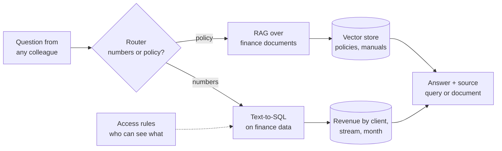

# Finance knowledge assistant

A self-service "ask finance" assistant for everyone outside finance. Ask about numbers ("What did client X bring in last month?") or policies ("What can I claim for a hotel abroad?") in plain language, and get an answer with its source. Built on synthetic B2B SaaS data.

## The problem

Finance gets the same questions every week from sales, delivery, HR and management:

- *What was the revenue of client X last month? And year to date?*
- *How is the subscription stream doing compared to last year?*
- *What's the travel expense policy for client visits?*
- *When is the month-end cut-off for invoices?*

Each one is simple, but together they eat hours of finance time, and colleagues wait days for answers they need now. The data and the rules exist. They're just locked in the ERP, the BI tool and policy PDFs that most people can't or won't search.

## The approach



1. **Question in:** a colleague asks in plain language, in chat or a simple web app.
2. **Routing:** the assistant decides whether it's a **numbers question** or a **policy question**.
3. **Numbers:** the question is translated into a query on a structured revenue table (client, revenue stream, month, actual, budget). Time phrases like "last month", "2 months ago", "this year" or "YTD" are resolved to exact periods. The figure comes from the query, never from the LLM's guess.
4. **Policies:** relevant sections are retrieved from finance documents (travel and expenses, procurement, close calendar, cost center rules) and the LLM answers using only those sources.
5. **Answer out:** a short answer plus how it was produced: the period and filters used for numbers, the document and section for policies. If the data or docs don't cover it, the assistant says so and points to the right person in finance.

### Guardrails

- **Access control:** users only see the numbers they're allowed to see (e.g. account managers see their own clients)
- **Numbers from data only:** the LLM writes the query and the sentence, never the figure
- **Clear definitions:** "revenue" means recognised revenue unless stated otherwise, and the answer says which
- **Audit log:** every question and answer is logged for review

## The result

Targets on the synthetic dataset:

- **Self-service:** most routine numbers and policy questions answered in seconds, without a ticket to finance
- **Trusted answers:** every figure shows its period and filters, every policy answer shows its source
- **Finance time back:** fewer interruptions, more time for analysis and business partnering

## Tools

Python, pandas, SQL, LLM APIs, text-to-SQL, RAG, embeddings, vector store

## Run it yourself

Coming soon ...

<!--
```bash
git clone https://github.com/mtuantruong/finance-knowledge-assistant.git
cd finance-knowledge-assistant
python -m venv .venv && source .venv/bin/activate
pip install -r requirements.txt
cp .env.example .env   # add your own API keys here, never commit .env
python src/main.py
```
-->

## Data

All data and documents in `data/` are synthetic and describe a fictional company. They do not reflect any real company's figures or policies.

## License

MIT
